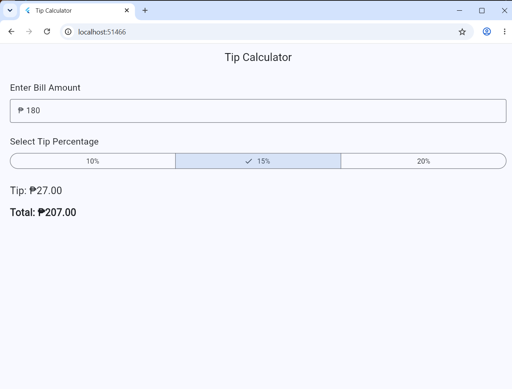

# Tip Calculator

**Developer:** Joshua Alexander Regalado

## Description

The Tip Calculator is a activity that i developed for my mobile programming subject. It allows the users to easily figure out tip amounts and total bills based on the selected tip value that they have in mind.

## Application Screenshot

